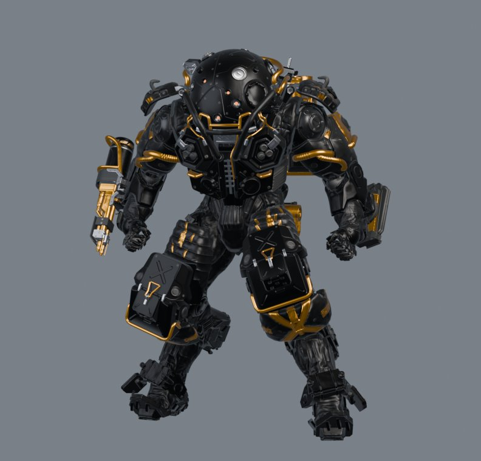
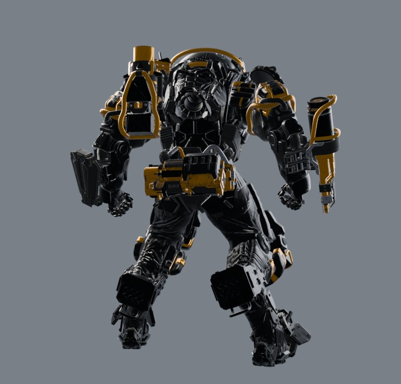
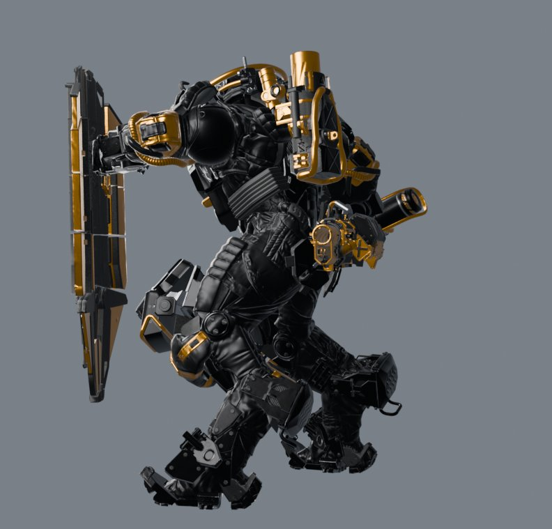
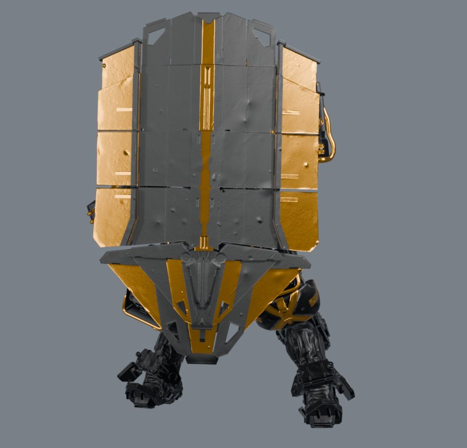
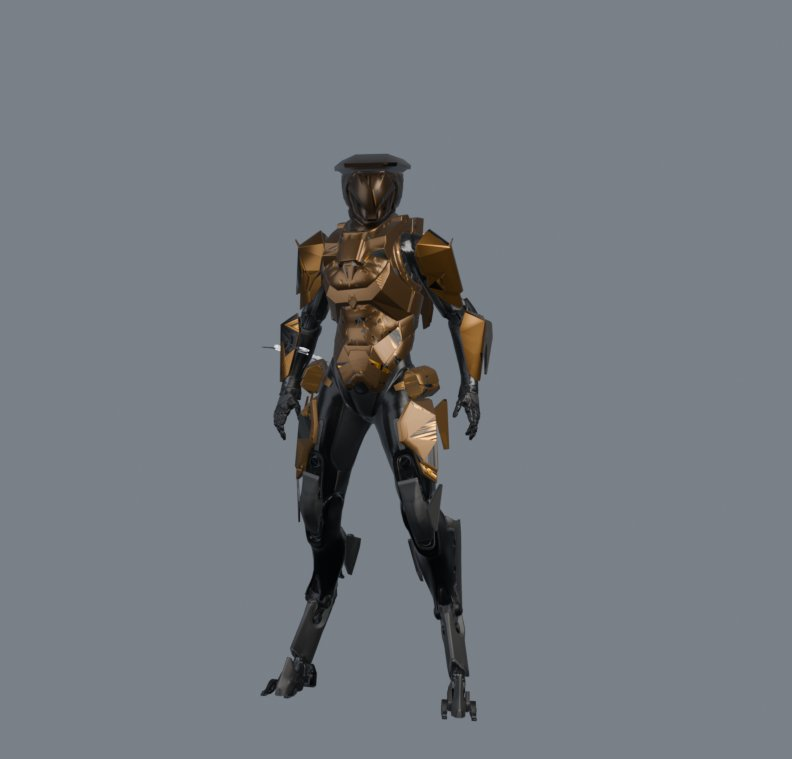
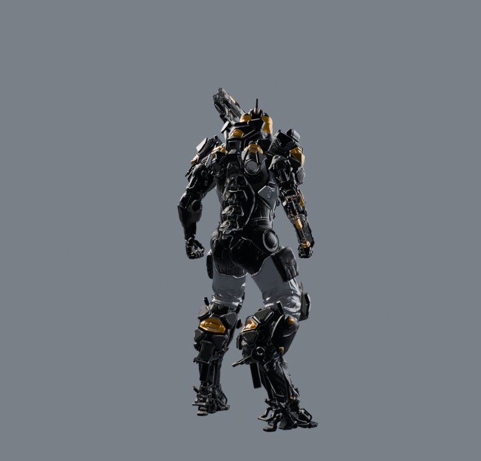
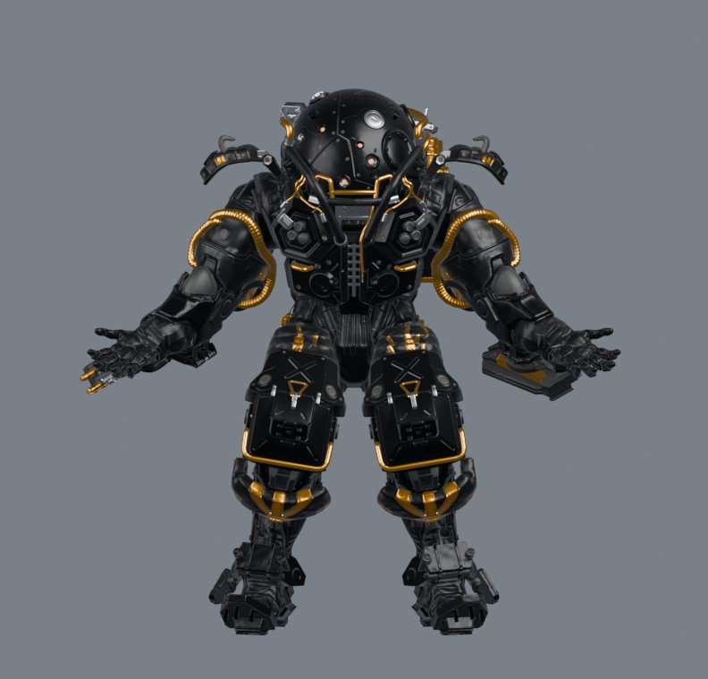
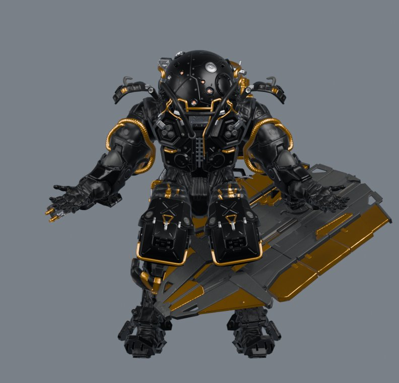

# Anthem Armour Builder

Pick a javelin, an armour set and gear. Get a rigged, textured, animated FBX (and a
ready-to-use `.blend`) for Blender, assembled entirely from Anthem's own game data:

- the armour set's meshes at LOD0, skinned to the game skeleton
- gear mounted on the game's sockets (bone and offset from the javelin's socket file)
- the Forge preview idle, the bind A-pose, and every gear animation, played together with
  the body animation the game pairs it with
- PBR maps (base colour, roughness, metallic, normal) baked from the game textures

| Colossus, Dark Grace (Forge idle) | | |
|---|---|---|
|  |  |  |

| Siege shield aim (gear + body clip) | Interceptor, Recon | Ranger, Alien |
|---|---|---|
|  |  |  |

## Requirements

- Windows, with Anthem installed (Origin/EA app, or any folder holding `Anthem.exe`,
  `Data`, `Patch` and `oo2core_7_win64.dll`)
- [Bforartists](https://www.bforartists.de/) or [Blender](https://www.blender.org/)
  (tested with Bforartists 5.2)
- Python 3.10+ (64-bit). The launcher installs Python 3.13 with winget if none is found;
  the builder installs its own packages (numpy, Pillow, texture2ddecoder).

Nothing else needs setting up. On first run the builder finds Anthem and
Bforartists/Blender (it asks once if it can't, and remembers the answer in `config.json`).

## Usage

### Window

Double-click **`Anthem Armour Builder.bat`**.

1. Choose a **javelin**. The first time, the game install is indexed (a few minutes, once),
   and the javelin's files are extracted and catalogued (about a minute per javelin, once).
2. Choose an **armour set**. Optionally mix parts from other sets under *Per-part override*.
3. Tick **gear**. Only one item per socket can be ticked, as in game.
4. Pick a **palette** and output folder, then **Build FBX**.

### Command line

```bash
python anthem_builder.py --list Colossus
python anthem_builder.py --javelin Colossus --set darkgrace --gear wrist_siegeshield --gear shoulder_mortar --gear wrist_sprayer --gear ultimate_gun
```

| Option | |
|---|---|
| `--list [JAVELIN]` | armour sets and gear (all javelins if none given) |
| `--javelin`, `--set` | Colossus / Interceptor / Ranger / Storm, and a set from `--list` |
| `--part part=set` | per-part override, e.g. `--part torso=outlaw` |
| `--gear NAME` | gear to mount (repeat for more) |
| `--palette` | `Dark Grace`, `Gunmetal`, `Ivory` |
| `--out DIR` | output folder (default `../builds`) |
| `--game DIR`, `--bforartists EXE` | override the detected paths |
| `--no-render` | skip the front/back preview renders |

### Output

`<out>/<Javelin>_<set>/`:

- `<Javelin>_<set>.fbx` armature, meshes, embedded textures, every animation as a take
- `<Javelin>_<set>.blend` the same scene, with collections and actions set up
- `<Javelin>_<set>_front.png`, `_back.png` previews
- `maps_<palette>/` the baked texture maps

## In Blender

Open the `.blend` (or import the `.fbx`).

- **Change pose or animation:** select the `<name>_rig` armature, open a *Dope Sheet* in
  *Action Editor* mode and pick an action:
  - `<name>_Forge`: the Forge idle with gear stowed (default)
  - `<name>_APose`: the game's bind A-pose with gear stowed
  - gear clips, e.g. `GCMS_MobileShield_Aim_Idle_FM` or `GMOR_Mortar_Fire`; where the game
    has a matching body clip (`EXH_MobileShield_Aim_Idle_FM`), the body plays it too
- **Collapsed or extended gear:** gear that stows folded (shield, cannons) comes twice, in
  `<gear> collapsed` and `<gear> extended` collections. Hide either with the eye icon in the
  Outliner.

  | A-pose, collapsed shield | A-pose, extended shield |
  |---|---|
  |  |  |

- **Raw bind pose:** Armature properties, *Pose*, **Rest Position** (gear shows unfolded).
- **Layering:** in the *Nonlinear Animation* editor, stack a body action and a gear-only clip.
- **Posing by hand:** Pose Mode (Ctrl+Tab), select bones, rotate with R; Alt+R / Alt+G to clear.

## How it works

1. **Game files.** The bundled [anthemtool](https://github.com/xyrin88/anthemtool) reads the
   install's layouts, TOCs and superbundles once into `data/game_index.sqlite` (every file's
   CAS archive and offset). After that only the files a javelin needs are decompressed into
   `data/game/`, once each; mesh and texture data follow when a build reads them.
2. **Catalogue** (`catalog.py`, per javelin). Armour sets follow appearance, model and mesh
   EBX references. The skeleton is the rig whose joints fit the frame mesh's skin weights.
   Gear comes from `equipment/gear/<class>/`, with its socket from `<javelin>_sockets.ebx`.
3. **Decoding.** MeshSets (planar vertex streams, half/float positions, 4-bone skinning
   through the render skeleton's bone order), textures (BC1/3/5/7, RGBA8), the ANT
   AssetBank format and Eclipse/Frame animation clips (smallest-three quaternions,
   quantised vectors).
4. **Build** (`build_fbx.py`, inside Bforartists/Blender). One armature: the javelin plus
   each gear rig, whose `AITrajectory` joint (its `RootSocket`) sits on the body socket.
   Meshes are skinned, actions keyed, previews rendered, and the `.blend` and `.fbx` saved.

## Limitations

- Paint uses preset palettes, not each set's real material and colour data.
- Gear and body clips are paired by name and played raw. The game's animation state
  machine (blending, additive layers, IK) is not run, body root motion is dropped, and
  additive and `RawAnimationAsset` clips are skipped. In a paired clip, gear sits on its
  socket, or where the clip authored it while that is on a hand (the Colossus's siege
  cannon); only the gear in use deploys.
- The stowed pose (collapsed idle when there is one) and the extended pose (aim idle) are
  chosen by clip name.
- Gear without its own rigged model in the gear folders (most Interceptor gear, for
  example) is not listed.
- Tested on the Colossus, Interceptor and Ranger; the Storm is catalogued but untested.

## License

MIT, see [LICENSE](LICENSE), which also credits anthemtool (MIT) and the Python
packages used. Anthem and its assets belong to Electronic Arts / BioWare. This
repository contains no game files, and the project is not affiliated with or endorsed
by them.
